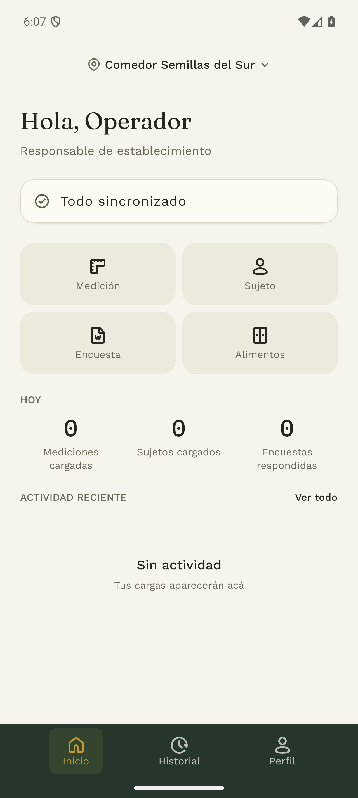
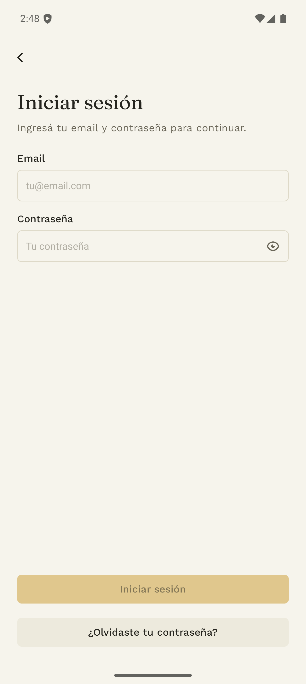
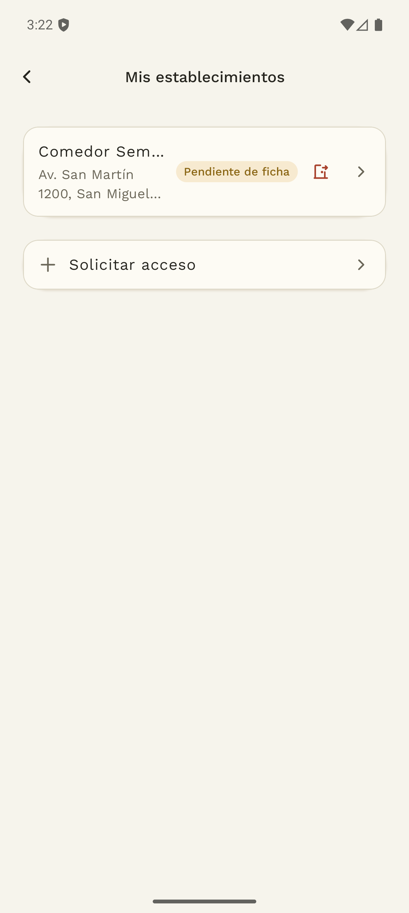
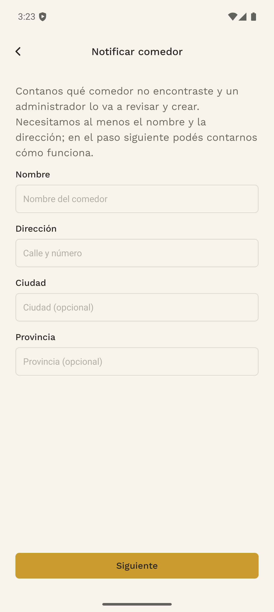
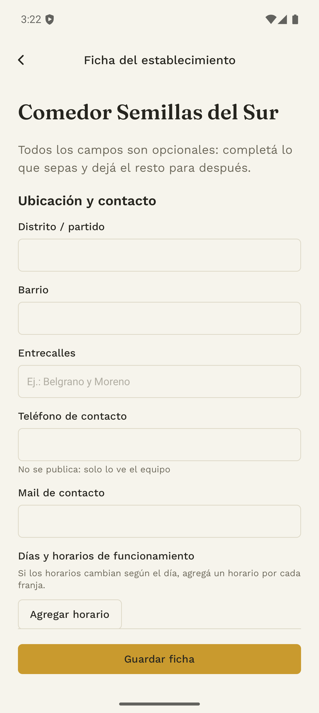
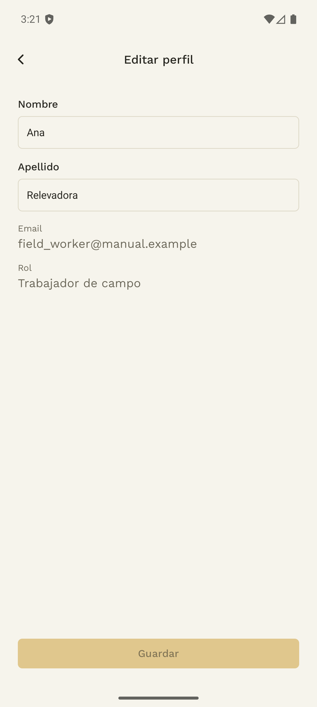

# 1. Acceso y trabajo en equipo

## 1.1 Conocer la app

El relevador o responsable de establecimiento usa la app móvil para registrar datos en el comedor. **Inicio**, **Historial** y **Perfil** están en la barra inferior. Inicio reúne los accesos a Medición, Sujeto, Encuesta, Alimentos y Recetas.

## 1.2 Registrarse como relevador

**Quién:** quien va a cargar datos en el comedor. **Dónde:** app.

1. En la bienvenida, tocá **Crear cuenta**.
2. Completá email, contraseña, nombre y apellido.
3. Si ya sabés dónde vas a trabajar, seleccioná uno o más establecimientos. Este paso es opcional.
4. Si corresponde, agregá localidad, descripción y teléfono de contacto.
5. Tocá **Crear cuenta** y revisá el aviso de registro enviado.
6. Abrí el correo de verificación y confirmá tu email.
7. Esperá la aprobación de la cuenta por un administrador antes de iniciar sesión.

La verificación del email y la aprobación de la cuenta son pasos diferentes. Una cuenta creada todavía puede estar pendiente de aprobación. Seleccionar un comedor durante el registro tampoco significa que el acceso haya sido aprobado.

Si el correo ya está registrado, usá **Iniciar sesión** o la recuperación de contraseña. Si alguno de los establecimientos ya no está disponible, revisá la selección y volvé a enviar el formulario.

## 1.3 Iniciar sesión y recuperar la contraseña

1. En la app, tocá **Iniciar sesión** e ingresá el email y la contraseña.
2. Si la cuenta está pendiente, pedí al administrador que revise el registro.
3. Si olvidaste la contraseña, elegí **¿Olvidaste tu contraseña?**, ingresá tu email y seguí el enlace del correo.
4. Definí la nueva contraseña y volvé a iniciar sesión.

Si el enlace venció o ya se usó, solicitá uno nuevo. Si el sistema pide esperar tras varios intentos, respetá el plazo indicado. Si la sesión vence durante el trabajo, volvé a ingresar y revisá el estado de las cargas en Historial antes de repetirlas.

## 1.4 Solicitar acceso a otro establecimiento

1. En **Perfil → Mis establecimientos**, elegí **Solicitar acceso**.
2. Buscá el comedor por nombre o dirección, seleccionalo y enviá la solicitud.
3. Revisá su estado: **Pendiente**, **Aprobado** o **Rechazado**.
4. Cuando el administrador lo apruebe, volvé a Inicio y elegí ese establecimiento.

La aprobación de la cuenta y la de cada comedor son independientes. Para dejar de trabajar en un comedor, usá la acción de retiro o baja en **Mis establecimientos** y confirmá. Si te revocaron el acceso, pedí al administrador que lo revise.

## 1.5 Notificar un comedor que no aparece

**Dónde:** **Perfil → Mis establecimientos → Solicitar acceso → ¿No encontrás tu comedor? Notificar**.

1. Completá el nombre y la dirección; agregá ciudad y provincia si las conocés.
2. Tocá **Siguiente** para completar la ficha, o **Contestar luego** para dejarla pendiente.
3. Enviá la solicitud y esperá la revisión del administrador.
4. Cuando se apruebe, comprobá que el comedor esté disponible y que tengas acceso.

Si el lugar ya existe, el sistema puede reutilizarlo para evitar duplicados. Una propuesta rechazada no crea un establecimiento. Revisá el estado antes de volver a enviarla.

## 1.6 Elegir el comedor antes de cargar

En **Inicio** de la app, tocá el nombre del establecimiento o **Elegí el establecimiento**. Seleccioná el lugar en el que estás trabajando y verificá el nombre antes de registrar mediciones o alimentos.

Cambiar el comedor cambia el contexto de las nuevas tareas. No mueve los registros que ya se guardaron en otro establecimiento. Si un formulario muestra su propio selector, comprobá también ese campo.

## 1.7 Completar la ficha del establecimiento

Con acceso aprobado, abrí la ficha desde **Perfil → Mis establecimientos** o desde el aviso **Pendiente de ficha · Completar**.

Completá lo que conozcas sobre ubicación y contacto, tipo de espacio, servicios, asistentes, alimentación y comunidad; después guardá. Los campos son opcionales. «Perfil completo» indica que la ficha tiene información; revisá el contenido antes de asumir que todos sus campos fueron respondidos.

La ficha del establecimiento es distinta de tu perfil personal.

## 1.8 Editar el perfil y cerrar sesión

En **Perfil → Editar perfil**, modificá los campos habilitados y guardá. El email y el rol son datos de consulta.

Para salir, elegí **Cerrar sesión** y confirmá. Antes de cambiar de cuenta o dispositivo, comprobá en Inicio e Historial que tus cargas estén sincronizadas.

**Cerrar sesión voluntariamente borra los datos locales de la app, incluidas las cargas que todavía no se sincronizaron.** Esperá a que terminen de subir antes de confirmar. Si la sesión venció, volvé a ingresar y revisá las cargas pendientes.

