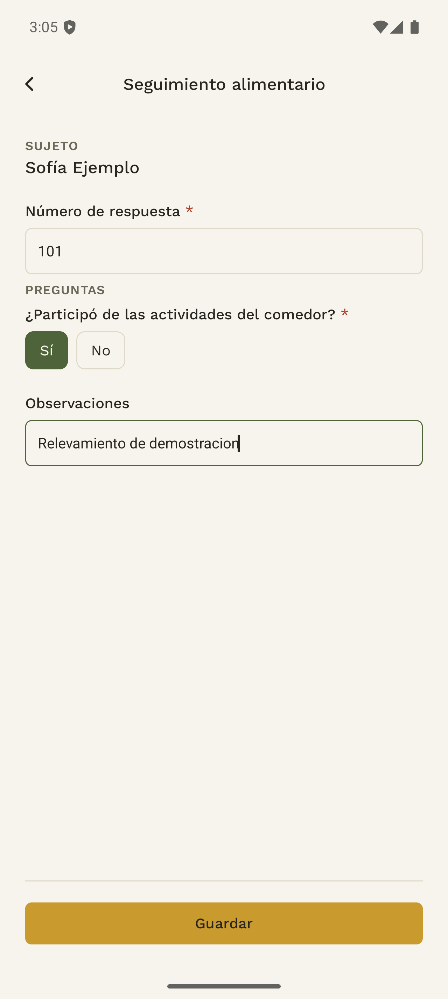
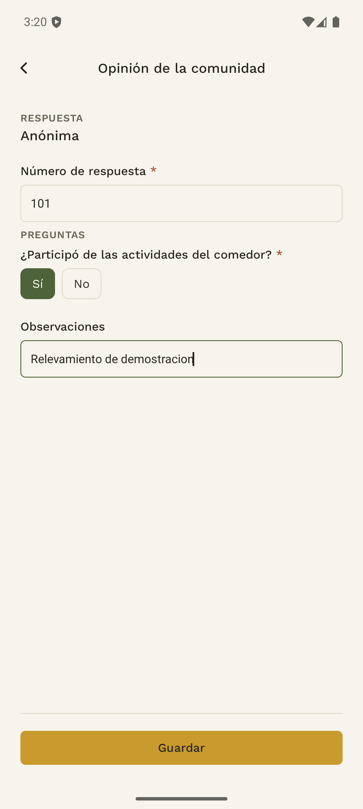
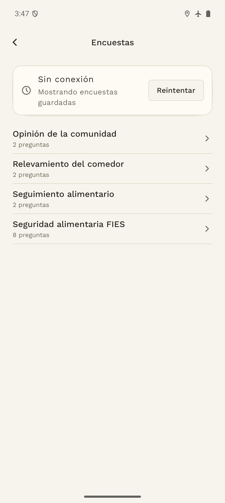
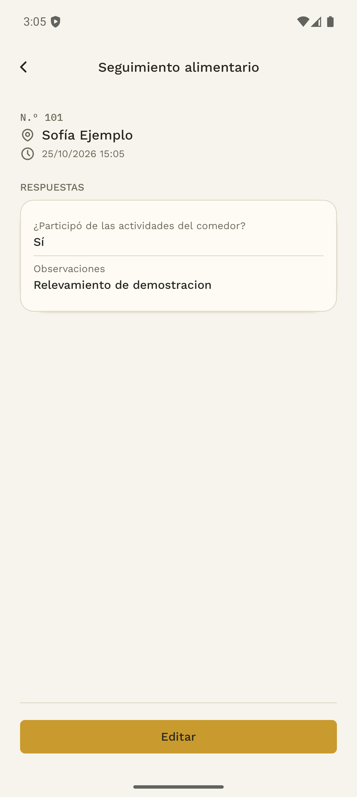
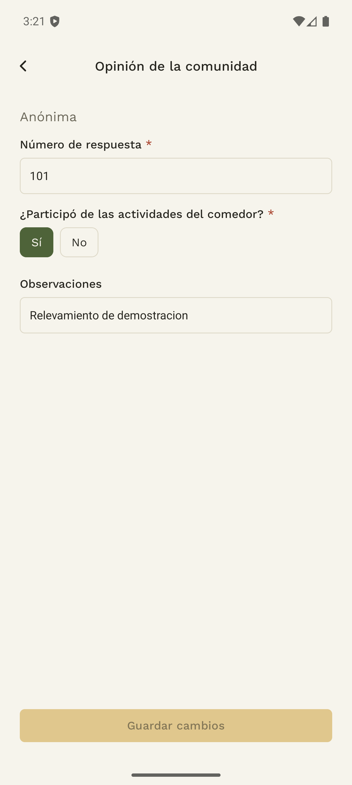

# 3. Encuestas

## 3.1 Elegir y responder desde la app

**Antes de empezar:** asegurate de tener cargado el sujeto o de haber elegido el establecimiento, según el destino del cuestionario.

1. En Inicio, tocá **Encuesta** y elegí una encuesta disponible.
2. Si es de sujetos, seleccioná la persona y comprobá su identidad.
3. Si es de establecimientos, verificá el comedor del encabezado. Si es anónima, el formulario indica **Anónima**.
4. Ingresá el **Número de respuesta** si corresponde. El rango admitido es de 1 a 999999.
5. Contestá las preguntas. En selección única elegís una opción; en selección múltiple podés marcar varias.
6. Tocá **Guardar**, corregí los campos señalados y comprobá el resultado.
7. Revisá la sincronización desde Inicio o Historial.

Para un sujeto o establecimiento se admite una respuesta por encuesta. Al guardar, la app vuelve al listado para evitar otra carga para ese mismo destinatario. Las encuestas anónimas permiten realizar varias entrevistas: la app limpia las respuestas y propone el siguiente número.

El número de respuesta sirve para identificar el relevamiento, pero puede repetirse. No reemplaza la comprobación del destinatario.

## 3.2 Responder sin conexión y resolver errores

Con conexión, abrí las encuestas que necesitás antes de ir a terreno. Sin internet, la app muestra **Mostrando encuestas guardadas** y depende de los formularios y destinatarios disponibles en el teléfono.

Las respuestas guardadas localmente se suben al recuperar conectividad. Si la encuesta fue desactivada antes de que la carga llegue al servidor, puede ser rechazada: revisá Historial y coordiná con quien administra el relevamiento.

Si una carga pendiente necesita completar el número, abrí **Agregar número**, ingresá un valor válido y usá **Guardar y reenviar**. Si el destinatario ya respondió, revisá la respuesta existente en lugar de crear otra.

## 3.3 Consultar y corregir una respuesta en la app

Desde **Historial**, entrá a las respuestas de encuestas y abrí el registro. El detalle permite revisar el cuestionario respondido y su número.

Cuando aparece **Editar**, corregí los campos necesarios y elegí **Guardar cambios**. Revisá el estado de la edición y la acción **Reintentar edición** si aparece. Una modificación pendiente todavía debe sincronizarse antes de considerarla compartida con el equipo.

